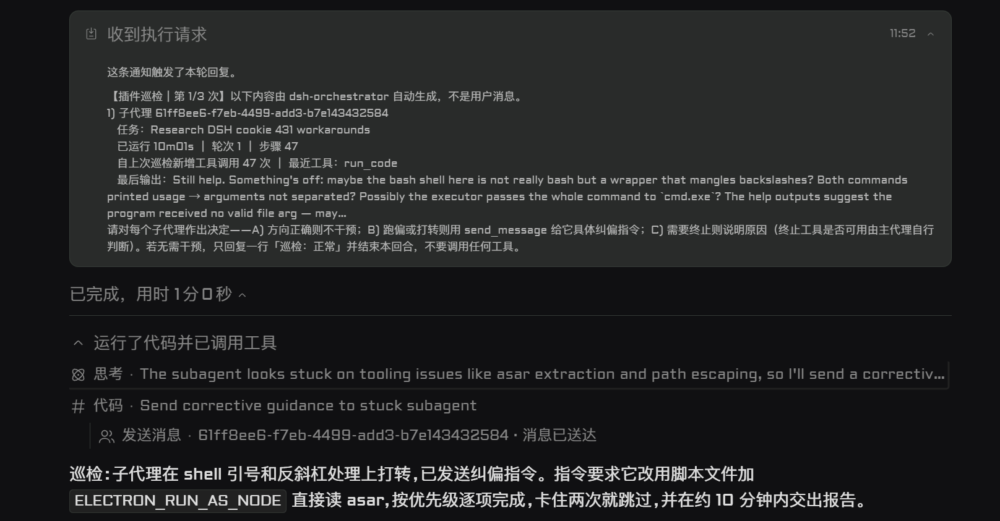
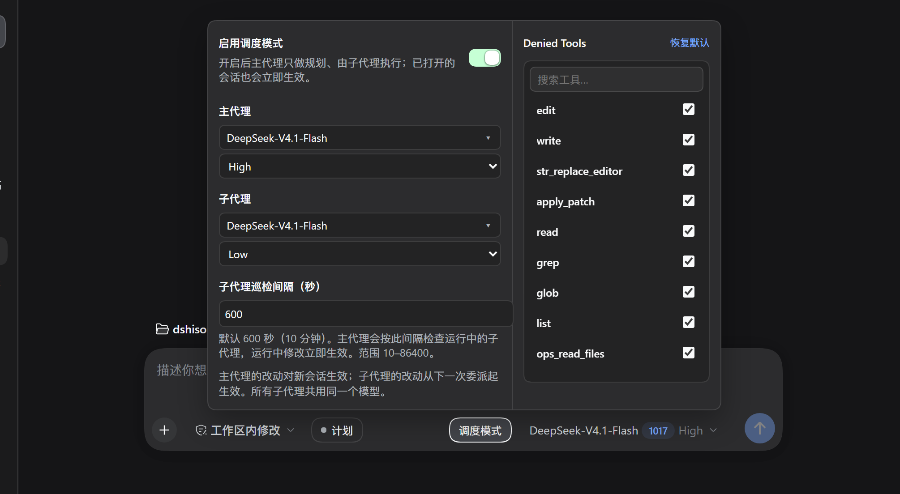

# DSH Orchestrator

[](https://github.com/SShiRkiT/dsh-orchestrator)

The "dispatch mode" plugin for DeepSeek Harness.
  
  The main agent only clarifies, plans, slices work, and accepts results
    
  Every concrete action is handed to subagents through `delegate` (asynchronous, on demand) or `orchestrate` (declarative batch).
    
  The main agent and the subagents have their default models and reasoning effort configured independently, and all subagents share the same subagent route.

[中文](README.md)

## How it differs from a plain single-agent session

| | Plain single-agent session | Dispatch mode |
| --- | --- | --- |
| Who executes | the main model calls tools itself | workers execute; the main agent only dispatches |
| Context | tool output piles up in the main agent context | each worker carries its own context |
| Parallelism | tool calls complete one after another | several workers run at once |
| Models | one model does everything | two routes, main agent and subagent |
| Boundaries | the model is expected to comply | the gate refuses by force |


## Key features

- **The main agent only plans, enforced by a gate**:
  
     a whitelist of 12 built-in planning and delegation tools (`DEFAULT_ALLOWED_TOOLS` / `allowedTools`) is all the main agent may call; every read, write, shell, web, and other host tool — plus any MCP or third-party plugin tool registered later — is hidden and refused at execution time (even a nested call smuggled through `run_code`); the main agent keeps only `delegate`, `orchestrate`, `send_message`, `todo_write`, `ask_user_question`, `compress`, `interrupt_agent`, plus the read-only session log tools (`session_*`).
  
- **Parallel dispatch of independent subtasks**:

    Independent subtasks go out together in the same turn; `delegate` has no plugin-side concurrency cap, while `orchestrate` limits how many workers are alive at once with `maxConcurrency` (1–16, default 4).
  
- **Supervision and correction**:
  
    When a `delegate` worker runs long, the plugin merges its session log into one notice that wakes the main agent; the main agent corrects it with a concrete `send_message`, or decides no intervention is needed and ends the turn with a one-line note.

    When a worker is interrupted with `interrupt_agent` and later woken again by `send_message`, supervision takes it back: the notice count restarts from the first notice, and the log from before the interruption does not count as new activity.
  
    
  
    *Each patrol notice summarises one running subagent — elapsed time, rounds, steps, new tool calls since the last patrol, latest tool, and last output — and the main agent then chooses to leave it alone (replying one line 「巡检：正常」), correct it with `send_message`, or terminate. In the screenshot the main agent sends corrective guidance to a subagent stuck on shell quoting and backslashes.*
  
- **Collecting results**:

    `delegate` returns `{ kind: "activation", subagentId }` immediately, and when the worker finishes the host delivers its result to the main agent as a message; `orchestrate` collects every result synchronously inside the tool call.
  
- **Declarative orchestration**:

    `orchestrate` does single-stage fan-out and multi-stage per-item pipelines (no global barrier); results keep input order, one failed item does not sink the others, and a stage can declare an object schema for structured results.

## Install

Add it from GitHub in the DSH plugin page, or use the CLI:

```text
SShiRkiT/dsh-orchestrator#main
```

```bash
dsh plugin --profile desktop add SShiRkiT/dsh-orchestrator#main
```

After installing, **fully quit and reopen DSH**: client plugins are composed at startup and are not hot-updated.

## Enable

1. Dispatch mode is already on after installing and restarting (`enabled` defaults to `true`).
2. In the composer's "Dispatch mode" panel, configure `workerProvider` and `workerModel` (required) and `workerReasoningEffort` (may stay empty, letting the model resolve its default effort); dispatching without a route fails outright instead of silently inheriting the main-agent model.
3. Turning off the "Enable dispatch mode" switch temporarily restores all main-agent tools and applies to already-open sessions immediately.
4. The Allowed Tools list on the right of the panel names every tool the host currently offers — read live at start and again whenever the registry changes, so tools another plugin or an MCP server registers are listed too: check a row to allow the main agent to use that tool, uncheck it to block it, and anything left unchecked — including a newly registered MCP or plugin tool — stays blocked by default; the dispatch tools (`delegate`, `orchestrate`, `send_message`, `todo_write`, `compress`) are rows like any other; "Reset to defaults" returns to the 12 built-in allowed tools. A checkbox change rebuilds the main agent's tool table at once, so an already-open session sees it on its next message, with no new session and no switch off/on.



*The dispatch mode panel: the enable switch, the main agent's and the subagents' models and reasoning effort, and the subagent patrol interval (default 600 s, range 10–86400); the Allowed Tools whitelist sits on the right.*

## Configuration

Every field is volatile: the host stores it and the plugin re-reads it on each use, so changing the configuration needs no restart.

| Field | Default | Meaning |
| --- | --- | --- |
| `enabled` | `true` | Master switch for dispatch mode. When off it revokes the hiding; the guard stays installed but lets calls through. |
| `allowedTools` | 12 built-ins | Whitelist-driven: the main agent may use only the tools listed here; every other host, MCP, or plugin tool is hidden and disabled automatically. Check a row in the panel's Allowed Tools column to allow it, uncheck to block it; effective on the next message. |
| `workerProvider` | `""` | Subagent provider; empty means unconfigured. |
| `workerModel` | `""` | Subagent model; empty means unconfigured. |
| `workerReasoningEffort` | `""` | Subagent reasoning effort; empty means it is not passed and the model resolves the default. |
| `superviseEnabled` | `true` | Master switch for supervision. |
| `superviseIntervalSeconds` | `600` | Supervision interval in seconds, an integer 10–86400. |
| `superviseMaxNoticesPerChild` | `3` | Most notices per subagent, an integer 0–20. `0` turns supervision off; the running child stays registered, so raising the number or switching unlimited on resumes it at once. |
| `superviseUnlimited` | `false` | Unlimited supervision. When on, the `superviseMaxNoticesPerChild` cap (including `0`) is ignored: as long as the child has not stopped, delivered or ended, it is reported every interval, and the notice header drops the denominator (`第 N 次`). |
| `superviseNotifyOnNoProgress` | `false` | Whether to also notify when the log has no new activity (unlimited supervision always reports). |
| `toolCatalog` | `[]` | The live tool catalog the plugin publishes: every tool name the host currently offers, which is how the panel lists tools beyond the 12 built-in allowed tools (MCP servers and other plugins included). Written by the plugin; do not edit it by hand. |

The main agent's default route is not part of this configuration: it lives in the host's `agent-default-model` (`provider` / `model` / `reasoningEffort`), is written by the same panel, and is read when a new agent is created.

## Usage

### delegate: one self-contained dynamic task

It has only three parameters: `prompt` (the complete task, required), `description` (a 3–5 word display name, required), and `cwd` (optional). The worker cannot see the main agent's conversation, so the prompt has to carry all the context itself:

```json
{
  "description": "move config loading",
  "prompt": "Goal: move config loading from config.ts to settings.ts without changing behaviour\nFiles you may change: src/config.ts, src/settings.ts\nAcceptance: node --test test/settings.test.mjs\nOn failure: do not change the public API; write the reason into the conclusion and stop"
}
```

Every worker gets the same fixed instruction at the start of its prompt: `用中文回复。` (answer in Simplified Chinese), followed by the requirement to end the turn with the final summary in the reply and not to call `send_message` to report completion, because the parent receives the closing message automatically. For several independent tasks, call `delegate` once each in the same message and they all start at once.

### orchestrate: batch dispatch

"One set of items × one fixed set of stages" goes to `orchestrate`, and one call collects every result; use `delegate` instead when you need to branch on intermediate results, loop, or reshape the dispatch while reading results. With a single stage, every item gets its own worker:

```json
{
  "items": ["alpha", "beta", "gamma"],
  "stages": [
    { "name": "summarize", "prompt": "Summarize this item in one sentence." }
  ],
  "maxConcurrency": 2
}
```

With several stages, items advance one by one and a later stage automatically receives the earlier output of the same item. `items` is 1–64 and `stages` is 1–8; the call returns `{ kind: "orchestration", agentsStarted, results, errors }`, with `results` in input order and `null` for a failed item.

`delegate` is asynchronous: there is no progress callback, and the main agent has no tool to stop a worker — stopping one takes a host-side action.

## License

MIT © 2026 SShiRkiT
