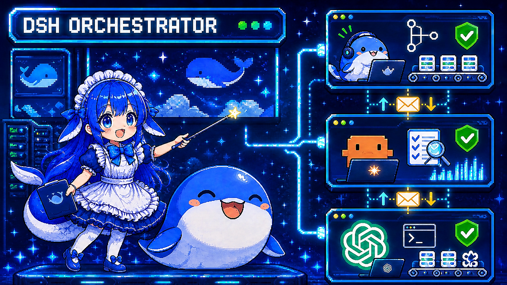
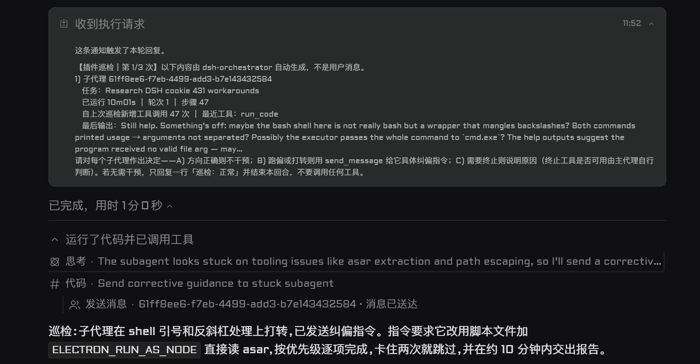

<div align="center">

*Start from 28th October*

<div align="center">

# dsh-orchestrator

</div>

#### **Main-agent model plans, subagent models execute in isolation — the Dispatch · Supervise · Coordinate · Aggregate orchestrator plugin for DeepSeek Harness**



[](https://github.com/SShiRkiT/dsh-orchestrator/releases/latest)
[](https://github.com/deepseek-ai/deepseek-harness)
[](https://github.com/SShiRkiT/dsh-orchestrator)
[](https://nodejs.org)
[](package.json)
[](LICENSE)
[](https://github.com/SShiRkiT/dsh-orchestrator/stargazers)
[](https://www.npmjs.com/package/@sshirkit/dsh-orchestrator)

**English** | [简体中文](README.zh.md) · [What It Adds](#what-it-adds) · [Core Advantages](#seven-core-advantages) · [Tool Reference](#tool-reference) · [Installation & Compatibility](#installation--requirements) · [Panel & Configuration](#dispatch-panel--configuration) · [Contributing](#contributing--community)

</div>

**dsh-orchestrator** is a main/subagent orchestration plugin for local DeepSeek Harness (DSH) engineering sessions: hard guardrails keep the **main agent** focused on understanding requirements, breaking down tasks, overseeing progress, and final review, while **subagents** handle concrete implementation in parallel and in isolation.

---

 https://github.com/user-attachments/assets/f540b545-c697-4bbc-abb2-d55f74041172

> [▶ Watch Bilibili Version](https://www.bilibili.com/video/BV1b7yBznEM9/)

---

<div align="center">

# What It Adds


It works smoothly alongside DSH's built-in collaboration tools and fills four practical gaps in intensive development:
</div>

**Keep the main model thinking, not doing chores**
> Hides and blocks file and terminal tools on the main agent so your flagship model doesn't drift into reading code or editing files directly.

**Isolated workspaces for every write task — merge only after review**
> Write tasks run in parallel inside separate temporary Git working directories by default, leaving your active checkout untouched and never merging into your main branch without approval.

**Background check-ins during work, delivery checks at handoff**
> Periodically watches running subagents in the background so stuck or drifting work can be nudged back on track via `send_message`;
> Verifies changed file scopes and required deliverables at handoff, and still reconciles state after restarts.

**One-shot parallel batches and multi-step pipelines**
> Run repetitive batches or multi-step pipelines without writing custom scripts — list the items and stages to advance automatically up to your concurrency cap, with single-item failures isolated.

---

<div align="center">

# Seven Core Advantages

</div>

### 1. Keep the Main Model Thinking, Not Doing Chores

This plugin puts a double lock on the main model — tools it shouldn't touch are both hidden and blocked, keeping it focused on planning, delegation, tracking, and review.

Hands-on work is left to subagents. Flip the master switch off anytime to restore DSH to normal without restarting the session.

- Allows 9 management actions by default
  > `delegate`, `orchestrate`, `delegate_status`, `worktree_manage`, `send_message`, `interrupt_agent`, `todo_write`, `ask_user_question`, `compress`
- Automatically allows native Agent Teams task-board tools (`team_task_*`) when enabled;
- All other file, search, and terminal tools are hidden by default and can be toggled live in the right-hand panel.

---

### 2. Dedicated Isolated Directory per Task — Merge Only When Satisfied

When multiple subagents edit code at once, the biggest risk is overwriting each other or messing up your active workspace.
Inside a Git repo, the plugin spins up a separate temporary working directory for each write task by default.
Finished work is never merged into your main branch behind your back — you or the main model inspect the changes first, then explicitly merge or discard them.

> Managed via `worktree_manage` to list, inspect diffs, merge (`merge` / `squash` / `ff-only`), discard, or prune;
> Supports switching between auto-isolation, strict isolation, and shared workspace modes. Once a directory is cleaned up or discarded, associated retired subagents are permanently locked so later messages can never write back into your main checkout by mistake.

---

### 3. Prevent Collisions Before Editing, Check Receipts at Handoff

When not using isolated directories, if two subagents try to edit overlapping files, the plugin blocks the conflict before startup. Each writable subagent declares its own `writeScope` to bound what it may change; if another subagent passes an overlapping `writeScope`, it is rejected with an error automatically.
At handoff, the plugin also checks whether a subagent touched files outside its scope or missed required deliverables, and flags read-only tasks that attempted to write. You can see every subagent's progress and audit status at a glance.

> Write tasks declare their allowed scope (`writeScope`), with optional tamper-check fingerprints (`expectedFingerprints`) and required output lists (`expectedTargets`);
> Call `delegate_status` anytime to inspect running, audited, and pending-review status across all subagents.

---

### 4. Dispatch Mode Panel

In the **Dispatch** panel next to the composer, main-agent and subagent models are configured completely separately:
- Both the default main model and default subagent model can be set explicitly.

> Specify a subagent model for a turn or workspace in your prompt or `AGENTS.md`. The main agent passes `provider` and `model` together and adds `reasoning_effort` only when requested.
> The workspace’s main-agent model can still be switched independently in DSH’s native model selector.

**Set up a tiered model routing table in `AGENTS.md` or your prompt**

Copy the table below into your workspace’s `AGENTS.md` or your prompt. The main agent reads and applies these rules; the plugin does not parse the table. An explicit route in the current message takes precedence over workspace rules. Replace the placeholders with actual provider and model IDs available in DSH. If no rule matches, omit all three route parameters.

| Task type | `provider` | `model` | `reasoning_effort` |
| --- | --- | --- | --- |
| Lightweight tasks (e.g. extraction or classification) | `<light-provider-id>` | `<light-model-id>` | Omit |
| Heavyweight tasks (e.g. architecture analysis or complex review) | `<heavy-provider-id>` | `<heavy-model-id>` | `high` (if supported by the model) |
| Other tasks | Omit | Omit | Omit |


---

### 5. Scheduled Background Check-Ins

On long-running tasks, a subagent may occasionally get stuck in an error loop, wander into the wrong directory, or go off on a tangent.
The plugin checks running subagents' activity logs in the background at your configured interval and folds recent progress into a short report for the main model to decide on — nudging drifting workers right back on track via `send_message`.

> Reading logs and summarizing progress spends zero model quota; a small amount of main-model quota is only used when waking the main model to review or steer;
> Steer via `send_message` or stop via `interrupt_agent`; check-in interval, notice cap, and "Unlimited checks" are all adjustable live in the panel, alongside silent Todo list restoration.



---

### 6. Seamless Hot Reloads, Honest Cold-Restart Reconciliation

When the plugin hot-reloads, running subagents stay connected and background check-ins continue seamlessly. Even if you fully quit and reopen DSH, the plugin first reconciles state automatically: confirmed-stopped subagents safely release their file locks, and tasks missing pre-dispatch records are honestly marked as "audit incomplete".

> Automatically uses the host's built-in storage to track worktrees, tasks, and file lock states (falling back to in-memory mode on older hosts with zero extra dependencies);
> After a full restart, interrupted old tasks are never blindly resumed, avoiding duplicate execution.

---

### 7. Batch Jobs and Multi-Step Pipelines — List It and Let It Run

For repetitive or multi-step jobs like "inspect → edit → verify across 20 files," you don't need to dispatch tasks one by one. Just provide the item list and stage sequence, and the plugin moves them forward within your concurrency limit: once an item finishes step 1 it jumps straight into step 2 without waiting on slower items, one failure never cancels the rest, and each step can enforce a strict output format.

> Powered by `orchestrate`, supporting 1–64 items × 1–8 stages and 1–16 concurrent workers (default 4), with optional per-stage JSON format checks; in isolated mode each item gets its own working directory reused across stages, excluded from background check-ins.

To explicitly select a model for a stage, pass `provider` and `model` together in that `stages` entry, with optional `reasoning_effort`. Each stage chooses one whole route: **stage override > top-level batch override > panel default worker route**. Routes are never combined, and reasoning effort is not inherited from a fallback route. The panel default is required only when a stage needs it; if it is missing, the batch starts no workers.

---

<div align="center">

# Tool Reference

</div>

The plugin exposes 4 orchestration and review tools exclusively to the main agent (hidden from subagents):

| Tool | What It Does | Common Parameters | Good to Know |
| --- | --- | --- | --- |
| `delegate` | Async task dispatch; supports parallel fan-out in one turn | `prompt`, `description`, `writeScope` (required for writes), `readOnly`, `isolation`, `expectedFingerprints`, `expectedTargets`, `cwd`, `provider` + `model`, optional `team_task_id` | Main agent only; auto-allocates an isolated directory or file lock for writes; attaches audit results at handoff and includes background check-ins |
| `orchestrate` | Parallel batch & multi-stage pipelines | `items` (1–64), `stages` (1–8, optional `schema`), `maxConcurrency` (1–16, default 4), `writeScope`, `readOnly`, `isolation`, `cwd`, optional top-level `team_task_id`; `provider` + `model` with optional `reasoning_effort` at the top level or per stage | Route priority: stage override > batch override > panel default. Items advance independently, reuse their own isolated directory, and run synchronously without background check-ins |
| `delegate_status` | One-stop acceptance overview for all subagents in this session | `childId` (optional), `includeCompleted` (default `true`), `limit` (1–64, default 20) | Read-only; separates run state, audit status, file locks, and directories awaiting review; missing records never mean "passed" |
| `worktree_manage` | List, inspect, merge, discard, or prune isolated directories | `action` (`list`/`inspect`/`merge`/`discard`/`prune`), `worktreeId` / `childId`, `strategy` (`merge`/`squash`/`ff-only`), `autoStageDirty`, `deleteAfterMerge`, `force`, `dryRun` | Main agent only; passing audit ≠ merged to your branch; merge conflicts preserve the scene; cleaning up or discarding locks retired workers |

When native Agent Teams is on for the host's root session and dispatch mode permits `team_task_create` in that session, the main agent can create a shared goal before dispatching complex work. Pass the returned `id` as `team_task_id`; subagents (every stage in `orchestrate`) can read the goal with `team_task_get` when available. Keep the task prompt self-contained: the shared goal is a reference, not a substitute for dispatch or write leases.

---

<div align="center">

# Installation & Requirements

</div>

| Item | Requirement |
| --- | --- |
| **Host environment** | DeepSeek Harness Desktop / Web GUI |
| **Host version** | `>= 0.2.2-rc.2 < 0.2.3-0` (verified through **`0.2.2-rc.5`**) |
| **Node.js** | `>= 22` (bundled with the DSH Desktop runtime) |
| **Plugin architecture** | Cordis backend service patch (`cordis.patch.yml`) + Web GUI client extension (`lib/client.js`) |
| **UI language** | Bilingual auto-switching (`zh-CN` / `en-US`) |

<div align="center">

# Version Compatibility

</div>

| npm Package | Plugin Version | Supported DSH Host | Notes |
| --- | --- | --- | --- |
| `@sshirkit/dsh-orchestrator` | `v1.0.0` onward | **DSH `>= 0.2.2-rc.2 < 0.2.3-0`** | Actively maintained; verified through `0.2.2-rc.5`. Incompatible with `0.2.2-rc.1` and earlier. `wait_agent` is intentionally excluded from the default whitelist (event-driven delivery + sidecar supervision replace blocking polling); check it manually in the panel if needed. |
| `dsh-orchestrator` (earlier unscoped package) | `v0.8.0` – `v0.8.2` | **DSH `<= 0.2.2-rc.1`** | Stay on `v0.8.2` if you cannot upgrade the host yet. |

<div align="center">

# Installation

</div>

**Option 1: DSH GUI**

Open the DSH Plugins page, choose **Add Plugin → Install Third-Party Plugin**, and enter any of the following valid specifiers (the first URL or npm package name is recommended):

```text
https://github.com/SShiRkiT/dsh-orchestrator
github:SShiRkiT/dsh-orchestrator#main
@sshirkit/dsh-orchestrator
```

**Option 2: CLI**

```bash
# Install from GitHub
dsh plugin --profile desktop add https://github.com/SShiRkiT/dsh-orchestrator
# Or install from npm
dsh plugin --profile desktop add @sshirkit/dsh-orchestrator
```

> If the **Dispatch** panel does not appear on the right of the composer after first install or a client update, fully quit and restart DSH.

---

<div align="center">

# Dispatch Panel & Configuration

</div>

## Right-Side Composer "Dispatch" Panel

The bilingual panel adapts automatically to DSH's locale and provides live controls without restarts:

- **Enable dispatch mode**: toggles the main-agent whitelist gate immediately for open conversations;
- **Enable Git Worktree isolation by default**: controls `isolation: "auto"` behavior for Git write tasks;
- **Main agent / Subagent default model & reasoning effort**: searchable model picker; main writes host `agent-default-model` (new sessions only), subagent applies from the next dispatch;
- **Subagent check interval / check count / Unlimited checks**: adjusts sidecar supervision live while workers run;
- **Right-hand `Allowed Tools` checklist**: search, check individual tools, or reset to defaults. Turn on **Only for this session** (shown as **仅当前会话** in Chinese) to edit a separate list for the current conversation. Turn it off to restore inheritance from the global list.

## Configuration Reference

All 13 user-configurable fields below are `volatile` (dynamic hot config, no restart required: execution gates reread per call, tool surfaces update on the next request, and worker routes apply on the next dispatch):

| Field | Default | Description |
| --- | --- | --- |
| `enabled` | `true` | Master switch for dispatch mode. Turning it off restores the native host tool surface; `delegate` / `orchestrate` stay disabled and bound supervision-turn hard locks still take priority. |
| `worktreeIsolationEnabled` | `true` | Controls whether `isolation: "auto"` creates isolated Git Worktrees with `git diff` / `git log` audits for Git write tasks (non-Git directories fall back to snapshot audits). |
| `allowedTools` | Unset (9 base tools; plus 4 registered native Team tools when `allowAgentTeam: true`) | Explicit main-agent tool whitelist. An explicit array (including `[]`) **replaces** the defaults rather than appending. The panel's `Allowed Tools` checklist updates this field when **Only for this session** is off. |
| `allowAgentTeam` | `true` | Controls only the main agent's access to native task-board tools (`team_task_*`) in dispatch mode; it does not switch host Agent Teams on or off. `false` overrides the session and global whitelists. When the root session has native Agent Teams on and its whitelist permits `team_task_create`, the main agent can create a shared goal and pass its ID as optional `team_task_id` for subagents to read. |
| `workerProvider` | `""` | Default worker route provider. When no explicit override applies, both this and `workerModel` are required; there is no fallback to the main model. |
| `workerModel` | `""` | Default worker route model; same requirement as above. |
| `workerReasoningEffort` | `""` | Default worker reasoning effort; leave empty to let the chosen worker model use its own default. |
| `superviseEnabled` | `true` | Master switch for background sidecar supervision (in the host plugin settings card). |
| `superviseIntervalSeconds` | `600` | Sidecar supervision interval in seconds (`10–86400`); changes apply immediately to running workers. |
| `superviseMaxNoticesPerChild` | `3` | Maximum supervision notices per subagent (`0–20`). When unlimited checks are off, `0` disables supervision. |
| `superviseUnlimited` | `false` | Ignores `superviseMaxNoticesPerChild` (including `0`) and continues checking at each interval until the worker stops, delivers, or ends. |
| `superviseNotifyOnNoProgress` | `false` | Whether to notify even when a worker's log shows no new activity (in the host plugin settings card; effectively always on when `superviseUnlimited` is enabled). |
| `restoreTodoOnSupervision` | `true` | Silently restores Todo UI state via `todo/write` from an eligible snapshot during supervision, with no model history entry and zero token cost (in the host plugin settings card). |

> Note: The config schema also includes `toolCatalog`, an **internal read-only runtime mirror** published automatically by the plugin so the Web panel can render the host's complete registered tool list — no manual editing is needed. The main agent's default model lives in the host's `agent-default-model`, read and written by the same Dispatch panel.

---

<div align="center">

# Contributing & Community

</div>

The Chinese README is maintained first, and this English version is kept in sync. These documents cover terminology, architecture decisions, contribution workflows, and support channels:

- Project glossary [`GLOSSARY.md`](docs/GLOSSARY.md)
- Architecture decision records (ADRs) [`docs/adr/`](docs/adr/)
- Release notes [`docs/releases/`](docs/releases/)
- Contribution guide [`.github/CONTRIBUTING.md`](.github/CONTRIBUTING.md)
- Code of conduct [`.github/CODE_OF_CONDUCT.md`](.github/CODE_OF_CONDUCT.md)
- Security policy and private vulnerability reporting [`.github/SECURITY.md`](.github/SECURITY.md)
- Support and help [`.github/SUPPORT.md`](.github/SUPPORT.md)
- Accessibility statement [`.github/ACCESSIBILITY.md`](.github/ACCESSIBILITY.md)

<div align="center">

# License

</div>

[MIT](LICENSE) © 2026 [SShiRkiT](https://github.com/SShiRkiT)
