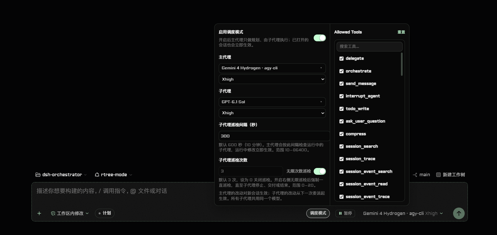

<div align="center">   
  
##### Start from 28th October

<div align="center">  
  
# DSH Orchestrator

</div>


#### **强模型主脑规划 + 便宜模型统一打工 —— DeepSeek Harness 的「硬隔离调度模式」插件**

[](https://github.com/SShiRkiT/dsh-orchestrator)
[](https://github.com/deepseek-ai/deepseek-harness)
[](https://github.com/SShiRkiT/dsh-orchestrator)
[](https://nodejs.org)
[](package.json)
[](LICENSE)
[](https://github.com/SShiRkiT/dsh-orchestrator/stargazers)

**简体中文** | [English](README.en.md) · [核心差异](#为什么有了原生-subagent-和-agent-team还需要这个插件) · [核心特性](#核心特性) · [安装](#安装) · [配置说明](#配置说明)

</div>


<div align="center">
  
## 核心特性
</div>

### 1. 强模型当 Main Agent，便宜模型当 Subagent（独立面板、即时生效）

在输入框下方的**「调度模式」专属面板**中，主代理与子代理的模型路由完全解耦：
- **主代理（Main Agent）**：配置为你最强的旗舰模型专门负责需求澄清、任务切分、途中纠偏与最终结果验收。
  - > 例如 `gpt-astra-6`、`claude-opus-5.5` 等
- **子代理（Subagent）**：配置为能力稍弱但极其便宜、高吞吐的模型**所有通过 `delegate` 和 `orchestrate` 派出的 Worker 强制共用这条便宜路由**
  - > 例如 `deepseek-v4.1-flash`、`gpt-luna-6` 等
- **防烧钱保护**：如果未配置子代理模型，派发时会直接报错拦截

## 可以在`prompt` 或 `AGENTS.md`中要求当前工作区域的main agent派发子代理时传输 `provider` / `model` 参数来指定当前`会话` \ `工作区`使用你指定的模型进行




### 2. 主代理「规划与验收」、子代理「纯粹 Work」的白名单式硬性闸门

不同于靠 Prompt 劝主模型“多用子代理”，本插件在 DSH 的工具声明出口（`tools.definitions`）与执行层（`tools.guard`）安装了双重守卫，且采用**白名单式驱动**：声明层实时裁剪模型可见的工具表（全局工具与 `ops_*` 等 scope 内工具一视同仁），执行层再兜底拒绝任何漏网调用；两层都按请求/按调用实时读取配置，不产生 `tools.restrict` 事件风暴，因此不会触发官方工具遮挡的抖动与 Prompt Cache 失效。
- **主代理被彻底收缴执行工具**：
<div align="center">
  
> ### DEFAULT_ALLOWED_TOOLS 默认只放行 12 项规划、委派与会话只读工具
> 
> _`delegate`、`orchestrate`、`send_message`、`interrupt_agent`、`todo_write`、`ask_user_question`、`compress` 与 5 项只读会话日志工具。_
> 
> ### 所有文件读写、搜索、终端，以及未来新增的任何 MCP / 第三方插件工具，一律自动隐藏并在执行层强制拦截
> 
>_（`read` / `edit` / `write` / `apply_patch`）、（`grep` / `glob`）、（`bash` / `pwsh`）、 `subagent` / `workflow`_
> 
> ### 连 run_code 嵌套偷调也拦。需要额外放行时，在面板右侧 Allowed Tools 勾选即可。
</div>

- **子代理独享完整工具链**：被派出的 Worker 不受闸门限制，在各自独立的上下文中读写文件、跑测试、看报错，完工后只把干净的结论交回主代理验收。
- **一键随时切换**：需要主代理临时亲自操作时，关掉面板上的「启用调度模式」开关即可立刻恢复主代理的全部工具，无需重开会话。

### 3. 后台事件日志定时巡检与强模型动态纠偏

便宜模型充当 Subagent 时，偶尔会在复杂的 shell 转义或报错上打转。插件内置了纯日志驱动的后台巡检器：
- **巡检读取本身不调用模型**：后台定时器直接读取运行中 Worker 的会话事件日志，按设定的巡检间隔（默认 600 秒）汇总它的运行时长、轮次、新增工具调用与最后输出，合并成一条通知唤醒主代理。读取与汇总环节不发起任何 LLM 请求
- 但**唤醒主代理后的判断与纠偏仍会消耗主代理的 token**：巡检的价值在于把「持续轮询」压缩成「一条摘要 + 一次决策」，而不是让整个巡检功能零消耗。
- **强模型一眼把关**：主代理收到巡检摘要后，只需极少 Token 即可做出决策：
  - **A) 进展正常**：回复一行 `巡检：正常` 结束回合，让子代理继续跑；
  - **B) 途中纠偏**：调用 `send_message` 直接向运行中的子代理注入修正指令（指明正确写法或跳过卡点）；
  - **C) 及时止损**：调用 `interrupt_agent` 中断失控的子代理（若后续再用 `send_message` 重新唤醒它，巡检会自动重新接管并重置通知计数）。


*巡检通知与纠偏实录：便宜的子代理卡在了 shell 引号和反斜杠转义上，巡检机制按间隔唤醒主代理后，主代理通过 `send_message` 直接给出正确写法完成纠偏。*

### 4. 专为调度模式定制的 `delegate` 与 `orchestrate`

- **`delegate`（按需异步单派 / 并行扇出）**：
  用于派发自包含的独立任务（目标 + 允许修改的文件 + 验收命令 + 失败兜底）。同一回合多次调用即可同时启动多个 Worker 并行施工；插件会为每个子代理统一注入简体中文回复指令，并要求它在收尾时直接输出最终总结、禁止调用 `send_message` 向父代理汇报（收尾消息会自动送达主代理）。
  **`writeScope`（必填，`string[]`）**：声明本次派发允许修改的文件或目录，支持精确文件（`src/index.js`）、目录（`dir/` 或 `dir/**`）与全局根（`*`）。相对路径按 `cwd` 词法归一化，Windows 下大小写不敏感判重；省略报 `write-scope-missing`，空数组 / 非法路径报 `write-scope-invalid`。
- **`orchestrate`（声明式批量流水线）**：
  用于处理「一组条目（`items`，1–64）× 固定多阶段步骤（`stages`，1–8）」的批量任务，通过 `maxConcurrency`（1–16，默认 4）控制并发。支持单阶段并行扇出与多阶段**逐条目无屏障流水线**（先做完阶段 1 的条目立刻进入阶段 2，不用傻等慢条目），支持阶段级 JSON Schema 强校验与单项失败隔离。
  **`writeScope`（必填，`string[]`）**：整批共用一条顶层声明，按整批**原子持有**写作用域；归一化后的作用域会自动注入每个阶段的 Prompt 作为边界提示。
- **单写者互斥（派发前拦截）**：`delegate` 按子代理持锁、`orchestrate` 按整批持锁，两者共享同一张进程级租约表并跨工具求交。一旦作用域相交，插件会在**启动任何子代理之前**直接抛出 `write-scope-conflict`（附冲突路径、持有者与到期时间，`agentsStarted: 0`），杜绝多个 Worker 同时覆写同一文件。租约在 `subagent/end`、`agent/disposed`、`orchestrate` 的 `finally`（含异常与 abort）以及插件卸载时幂等释放，另有 30 分钟 TTL 兜底防泄漏。


---
<div align="center">
  
### 为什么有了原生 `subagent` 和 `Agent Team`，还需要这个插件？
</div>
DSH 客户端自带了 `subagent` / `workflow`，官方也有 `@deepseek-ai/dsh-experimental-agent-team-profile`（Agent Team），但它们在实际高强度开发中仍有三个痛点——而这正是 **DSH Orchestrator** 独有的设计核心：

| 痛点场景 | 原生 `subagent` / 官方 `Agent Team` | DSH Orchestrator（本插件独有） |
| --- | --- | --- |
| **主代理总忍不住自己动手** | **靠自觉（软提示词）**：主代理 / Team Lead 手里依然握有 `read`、`edit`、`bash` 等全套工具，聊几轮就经常脱轨亲自去读文件、跑命令，瞬间撑爆主上下文 | **白名单式驱动（Whitelist-Driven Hard Gate）**：主代理默认仅放行 12 项规划与委派核心工具（`allowedTools`），其余一切宿主读写/终端工具及未来新增的 MCP/第三方插件工具一律自动隐藏并在执行层强制拦截（连 `run_code` 嵌套偷调也拦），**逼迫 Main Agent 100% 只做规划与验收，Subagent 100% 只干苦力活** |
| **便宜模型干活卡死/跑偏** | **运行期黑盒**：派出后只能干等结束或超时，或者靠 `wait_agent` 阻塞轮询 | **后台事件日志定时巡检 + 强模型动态纠偏**：后台定时器直接读取运行中 Worker 的会话事件日志（读取与汇总本身不调用模型），汇总运行时长、轮次、新增工具调用与最后输出；异常或超时时以一条轻量摘要通知唤醒主代理，由强模型判断后精准纠偏 |
| **大批量同构任务** | 原生 `workflow` 让模型手写任意 JS 脚本，容易失控且模型路由不统一 | **声明式 `orchestrate` 流水线**：`items × stages` 结构化扇出与多阶段流水线，单项失败隔离、支持 JSON Schema 强校验，全部 Worker 强制走便宜的子代理路由 |


<div align="center">
  
## 环境要求

</div>

  
| 项目 | 要求 |
| --- | --- |
| **宿主环境** | DeepSeek Harness Desktop / Web GUI |
| **Node.js** | `>= 22`（内置于 DSH Desktop 运行时） |
| **插件形态** | Cordis 后端服务补丁（`cordis.patch.yml`）+ Web GUI 客户端扩展（`lib/client.js`） |
| **界面语言** | 中 / 英双语自适应（`zh-CN` / `en-US`） |

<div align="center">
  
### 与 DSH 宿主的版本兼容性

</div>

插件依赖宿主的子代理接口（`startActivation` 的 spec 形状、重试投递入口、根代理枚举、工具注册表），这些接口在 DSH `0.2.2-rc.2` 发生过一次不兼容变更，因此**插件版本与宿主版本必须成对选择**：

| 插件版本 | 适配的 DSH 宿主 | 说明 |
| --- | --- | --- |
| `@sshirkit/dsh-orchestrator >= 0.8.3`（当前版本 `0.8.5`） | **DSH `>= 0.2.2-rc.2`** | 已验证 `0.2.2-rc.2` / `0.2.2-rc.3`。宿主自 `0.2.2-rc.2` 起扁平化了 subagent spec、移除了 `Symbol.for('dsh.subagent.deliverPrompt')` 投递入口与 `agents.roots()`，并新增 `wait_agent` 工具；因此**不兼容 `0.2.2-rc.1` 及更早版本**。注意：宿主虽新增了 `wait_agent`，但本插件默认白名单**有意维持 12 项、不予放行 `wait_agent`**——阻塞式轮询等待会让主代理陷入空转与超时误判，巡检机制已用「一条摘要 + 一次决策」替代轮询；确有需要时可在面板 `allowedTools` 中手动勾选放行。 |
| `dsh-orchestrator 0.8.0 – 0.8.2` | **DSH `<= 0.2.2-rc.1`** | 已实测支持 `0.2.1-rc.3`、`0.2.2-rc.1`。自 `0.8.0` 起引入 `@deepseek-ai/dsh-tools` 依赖。 |
| `dsh-orchestrator <= 0.7.3` | `0.8.0` 之前的旧版 DSH | 早期独立工具注册架构，未依赖 `@deepseek-ai/dsh-tools`。 |

> 升级前请先确认宿主版本：在 DSH 中查看「关于」或读取安装目录下的 `package.json`。**插件 `0.8.3+` 配 `0.2.2-rc.1` 及更早宿主会在派发时直接报错**；反之，旧插件配 `0.2.2-rc.2+` 宿主同样不可用。若暂时无法升级宿主，请停留在插件 `v0.8.2`。

---

<div align="center">
  
## 安装

</div>

在 DSH 插件页选择「从 GitHub 添加」，下列三种写法都接受，直接填入输入框即可（推荐第一种，最不容易被客户端误判）：

```text
https://github.com/SShiRkiT/dsh-orchestrator
github:SShiRkiT/dsh-orchestrator#main
SShiRkiT/dsh-orchestrator#main
```

```bash
# CLI 等价安装
dsh plugin --profile desktop add https://github.com/SShiRkiT/dsh-orchestrator
# npm 安装（npm 发布后可用）
dsh plugin --profile desktop add @sshirkit/dsh-orchestrator
```

> 装完后请**完全退出并重新打开 DSH**（客户端插件在启动时组合，不支持热更新）。升级时请先在插件页**卸载旧版**再重新添加本仓库或 `@sshirkit/dsh-orchestrator`（npm 发布后可用），两份同时存在会争抢同一批工具声明。

---

<div align="center">
  
## 配置说明

</div>

所有配置项均为 volatile（动态热配置），在面板中修改后立即生效，无需重启 DSH：

| 字段 | 默认值 | 说明 |
| --- | --- | --- |
| `enabled` | `true` | 调度模式总开关。关闭时立即对当前会话恢复主代理全部工具。 |
| `workerProvider` / `workerModel` | `""` | 子代理默认模型路由（必填，未配置时派发直接报错，绝不静默继承主代理模型）。 |
| `workerReasoningEffort` | `""` | 子代理思考强度，留空则由所选模型自行决定默认值。 |
| `allowedTools` | 12 项内置白名单 | 白名单式驱动：主代理仅可使用列表内的工具，其余宿主/MCP/插件工具自动隐藏并禁用；面板右侧 Allowed Tools 可直接勾选放行或取消勾选禁用，下一条消息即刻生效。 |
| `superviseEnabled` | `true` | 子代理后台巡检总开关。 |
| `superviseIntervalSeconds` | `600` | 巡检间隔（秒），范围 10–86400，运行中修改立即生效。 |
| `superviseMaxNoticesPerChild` | `3` | 每个子代理最多发送几次巡检通知（0–20）。`0` 表示关闭巡检（运行中的子代理仍保留在注册表中，改回 >0 或打开无限巡检后立即恢复）。 |
| `superviseUnlimited` | `false` | 无限次数巡检开关。开启后忽略 `superviseMaxNoticesPerChild` 上限（含 `0`），只要子代理没有停止 / 交付 / 结束，就按间隔持续巡检，通知标题不带分母（`第 N 次`）。 |
| `superviseNotifyOnNoProgress` | `false` | 子代理日志无新活动时是否仍然发送通知（开启 `superviseUnlimited` 时等效于始终发送）。 |

> 注：主代理的默认模型保存在宿主的 `agent-default-model` 中，由同一个「调度模式」面板直接读写，对新创建的会话生效；子代理模型改动从下一次委派起立即生效。

<div align="center">
  
## License

</div>

[MIT](LICENSE) © 2026 [SShiRkiT](https://github.com/SShiRkiT)
