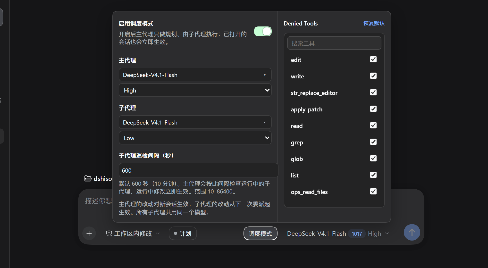
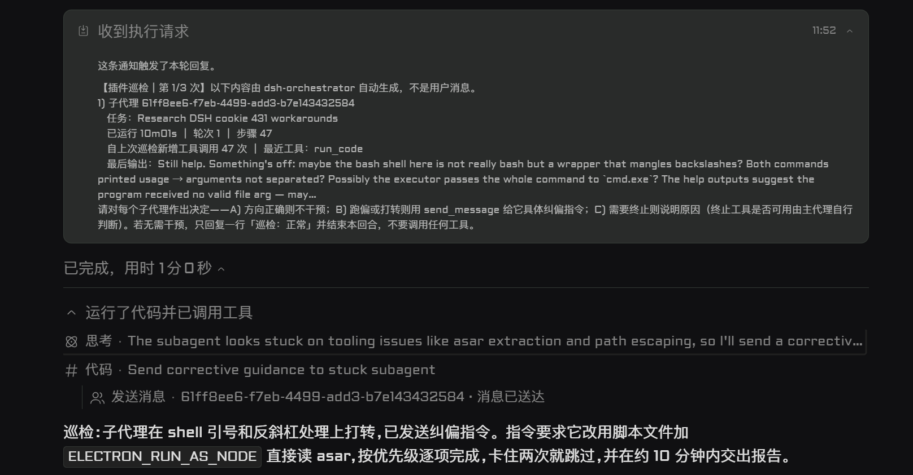

<div align="center">
**DSH Orchestrator**
</div>
<div align="center">

**强模型主脑规划 + 便宜模型统一打工 —— DeepSeek Harness 的「硬隔离调度模式」插件**

[](https://github.com/SShiRkiT/dsh-orchestrator)
[](https://github.com/deepseek-ai/deepseek-harness)
[](https://github.com/SShiRkiT/dsh-orchestrator)
[](https://nodejs.org)
[](package.json)
[](LICENSE)
[](https://github.com/SShiRkiT/dsh-orchestrator/stargazers)

**简体中文** | [English](README.en.md) · [核心差异](#为什么有了原生-subagent-和-agent-team还需要这个插件) · [核心特性](#核心特性) · [安装](#安装) · [配置说明](#配置说明)

</div>

---

## 为什么有了原生 `subagent` 和 `Agent Team`，还需要这个插件？

DSH 客户端自带了 `subagent` / `workflow`，官方也有 `@deepseek-ai/dsh-experimental-agent-team-profile`（Agent Team），但它们在实际高强度开发中仍有三个痛点——而这正是 **DSH Orchestrator** 独有的设计核心：

| 痛点场景 | 原生 `subagent` / 官方 `Agent Team` | DSH Orchestrator（本插件独有） |
| --- | --- | --- |
| **如何省钱配模型？**<br>*(最核心差异)* | **无独立子代理面板**：子代理要么默认继承昂贵的主模型，要么靠主模型每次调用时自己传参选模型（容易忘传或乱选，改默认模型还得改静态配置） | **双路由独立面板 + 强制锁定便宜模型**：在 UI 面板直接把 Main Agent 设为昂贵强模型（如 `gemini-4-argon-high`），把 Subagent 统一锁死为廉价快模型（如 `gemini-3.8-flash`），改完下一次委派立即生效 |
| **主代理总忍不住自己动手？** | **靠自觉（软提示词）**：主代理 / Team Lead 手里依然握有 `read`、`edit`、`bash` 等全套工具，聊几轮就经常脱轨亲自去读文件、跑命令，瞬间撑爆主上下文 | **白名单式驱动（Whitelist-Driven Hard Gate）**：主代理默认仅放行 12 项规划与委派核心工具（`allowedTools`），其余一切宿主读写/终端工具及未来新增的 MCP/第三方插件工具一律自动隐藏并在执行层强制拦截（连 `run_code` 嵌套偷调也拦），**逼迫 Main Agent 100% 只做规划与验收，Subagent 100% 只干苦力活** |
| **便宜模型干活卡死/跑偏怎么办？** | **运行期黑盒**：派出后只能干等结束或超时，或者靠 `wait_agent` 阻塞轮询 | **零 Token 后台巡检唤醒**：后台定时静默扫描子代理事件日志（不调模型、零 Token 消耗），超时或卡壳时自动汇总摘要唤醒主代理，由强模型发消息精准纠偏 |
| **大批量同构任务怎么跑？** | 原生 `workflow` 让模型手写任意 JS 脚本，容易失控且模型路由不统一 | **声明式 `orchestrate` 流水线**：`items × stages` 结构化扇出与多阶段流水线，单项失败隔离、支持 JSON Schema 强校验，全部 Worker 强制走便宜的子代理路由 |

---

## 核心特性

### 1. 强模型当 Main Agent，便宜模型当 Subagent（独立面板、即时生效）

在输入框下方的**「调度模式」专属面板**中，主代理与子代理的模型路由完全解耦：
- **主代理（Main Agent）**：配置为你最强的旗舰模型（例如 `gpt-astra-6`、`claude-opus-5.5` 等），专门负责需求澄清、任务切分、途中纠偏与最终结果验收。
- **子代理（Subagent）**：配置为能力稍弱但极其便宜、高吞吐的模型（例如 `deepseek-v4.1-flash`、`gpt-luna-6` 等），**所有通过 `delegate` 和 `orchestrate` 派出的 Worker 强制共用这条便宜路由**（除非用户在当前消息里明确点名要求临时换模型）。
- **防烧钱保护**：如果未配置子代理模型，派发时会直接报错拦截，**绝不静默回退去烧昂贵的主代理模型**。



*调度模式面板：左侧独立配置主代理（如 `gemini-4-argon-high`）与子代理（如 `gemini-3.8-flash`）各自的模型、思考强度及巡检间隔；右侧 Allowed Tools（白名单式驱动）实时拉取宿主全部工具（含 MCP 与其他插件工具），勾选即放行给主代理、未勾选（含新装插件工具）默认自动禁用，无需重启，下一条消息立即对当前会话生效。*

### 2. 主代理「规划与验收」、子代理「纯粹 Work」的白名单式硬性闸门

不同于靠 Prompt 劝主模型“多用子代理”，本插件在 DSH 工具层安装了双重守卫（`tools.restrict` + `tools.guard`），且采用**白名单式驱动**：
- **主代理被彻底收缴执行工具**：`DEFAULT_ALLOWED_TOOLS` 默认只放行 12 项规划、委派与会话只读工具——`delegate`、`orchestrate`、`send_message`、`interrupt_agent`、`todo_write`、`ask_user_question`、`compress` 与 5 项只读会话日志工具。所有文件读写（`read` / `edit` / `write` / `apply_patch`）、搜索（`grep` / `glob`）、终端（`bash` / `pwsh`）、网页抓取、原生 `subagent` / `workflow`，以及未来新增的任何 MCP / 第三方插件工具，一律自动隐藏并在执行层强制拦截（连 `run_code` 嵌套偷调也拦）。需要额外放行时，在面板右侧 Allowed Tools 勾选即可。
- **子代理独享完整工具链**：被派出的 Worker 不受闸门限制，在各自独立的上下文中读写文件、跑测试、看报错，完工后只把干净的结论交回主代理验收。
- **一键随时切换**：需要主代理临时亲自操作时，关掉面板上的「启用调度模式」开关即可立刻恢复主代理的全部工具，无需重开会话。

### 3. 零 Token 后台巡检与强模型动态纠偏

便宜模型充当 Subagent 时，偶尔会在复杂的 shell 转义或报错上打转。插件内置了纯日志驱动的后台巡检器：
- **零额外 Token 消耗**：后台定时器直接读取运行中 Worker 的会话事件日志（不调用任何 LLM），按设定的巡检间隔（默认 600 秒）汇总它的运行时长、轮次、新增工具调用与最后输出，合并成一条通知唤醒主代理。
- **强模型一眼把关**：主代理收到巡检摘要后，只需极少 Token 即可做出决策：
  - **A) 进展正常**：回复一行 `巡检：正常` 结束回合，让子代理继续跑；
  - **B) 途中纠偏**：调用 `send_message` 直接向运行中的子代理注入修正指令（指明正确写法或跳过卡点）；
  - **C) 及时止损**：调用 `interrupt_agent` 中断失控的子代理（若后续再用 `send_message` 重新唤醒它，巡检会自动重新接管并重置通知计数）。



*巡检通知与纠偏实录：便宜的子代理卡在了 shell 引号和反斜杠转义上，巡检机制按间隔唤醒主代理后，主代理通过 `send_message` 直接给出正确写法完成纠偏。*

### 4. 专为调度模式定制的 `delegate` 与 `orchestrate`

- **`delegate`（按需异步单派 / 并行扇出）**：
  用于派发自包含的独立任务（目标 + 允许修改的文件 + 验收命令 + 失败兜底）。同一回合多次调用即可同时启动多个 Worker 并行施工；插件会为每个子代理统一注入简体中文回复指令，并要求它在收尾时直接输出最终总结、禁止调用 `send_message` 向父代理汇报（收尾消息会自动送达主代理）。
- **`orchestrate`（声明式批量流水线）**：
  用于处理「一组条目（`items`，1–64）× 固定多阶段步骤（`stages`，1–8）」的批量任务，通过 `maxConcurrency`（1–16，默认 4）控制并发。支持单阶段并行扇出与多阶段**逐条目无屏障流水线**（先做完阶段 1 的条目立刻进入阶段 2，不用傻等慢条目），支持阶段级 JSON Schema 强校验与单项失败隔离。

---

## 环境要求

| 项目 | 要求 |
| --- | --- |
| **宿主环境** | DeepSeek Harness Desktop / Web GUI |
| **Node.js** | `>= 22`（内置于 DSH Desktop 运行时） |
| **插件形态** | Cordis 后端服务补丁（`cordis.patch.yml`）+ Web GUI 客户端扩展（`lib/client.js`） |
| **界面语言** | 中 / 英双语自适应（`zh-CN` / `en-US`） |

---

## 安装

在 DSH 插件页选择从 GitHub 添加，或使用 CLI：

```text
SShiRkiT/dsh-orchestrator#main
```

```bash
dsh plugin --profile desktop add SShiRkiT/dsh-orchestrator#main
```

装完后请**完全退出并重新打开 DSH**（客户端插件在启动时组合，不支持热更新）。

---

## 配置说明

所有配置项均为 volatile（动态热配置），在面板中修改后立即生效，无需重启 DSH：

| 字段 | 默认值 | 说明 |
| --- | --- | --- |
| `enabled` | `true` | 调度模式总开关。关闭时立即对当前会话恢复主代理全部工具。 |
| `workerProvider` / `workerModel` | `""` | 子代理默认模型路由（必填，未配置时派发直接报错，绝不静默继承主代理模型）。 |
| `workerReasoningEffort` | `""` | 子代理思考强度，留空则由所选模型自行决定默认值。 |
| `allowedTools` | 12 项内置白名单 | 白名单式驱动：主代理仅可使用列表内的工具，其余宿主/MCP/插件工具自动隐藏并禁用；面板右侧 Allowed Tools 可直接勾选放行或取消勾选禁用，下一条消息即刻生效。 |
| `superviseEnabled` | `true` | 子代理后台巡检总开关。 |
| `superviseIntervalSeconds` | `600` | 巡检间隔（秒），范围 10–86400，运行中修改立即生效。 |
| `superviseMaxNoticesPerChild` | `3` | 每个子代理最多发送几次巡检通知（0–20）。`0` 表示关闭巡检（运行中的子代理仍保留在注册表中，改回 >0 或打开无限巡检后立即恢复）。 |
| `superviseUnlimited` | `false` | 无限次数巡检开关。开启后忽略 `superviseMaxNoticesPerChild` 上限（含 `0`），只要子代理没有停止 / 交付 / 结束，就按间隔持续巡检，通知标题不带分母（`第 N 次`）。 |
| `superviseNotifyOnNoProgress` | `false` | 子代理日志无新活动时是否仍然发送通知（开启 `superviseUnlimited` 时等效于始终发送）。 |

> 注：主代理的默认模型保存在宿主的 `agent-default-model` 中，由同一个「调度模式」面板直接读写，对新创建的会话生效；子代理模型改动从下一次委派起立即生效。

## License

[MIT](LICENSE) © 2026 [SShiRkiT](https://github.com/SShiRkiT)
