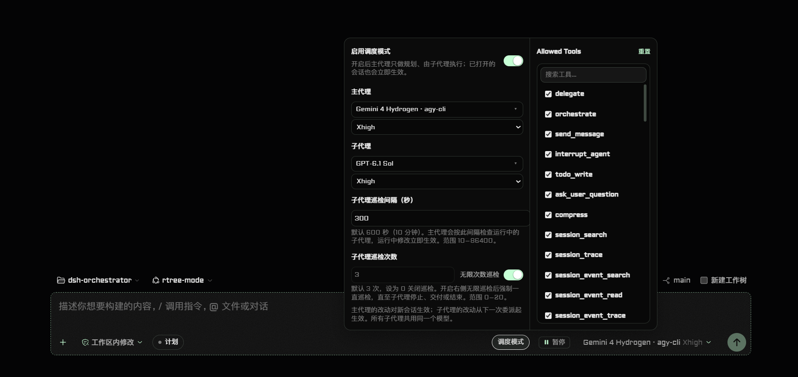
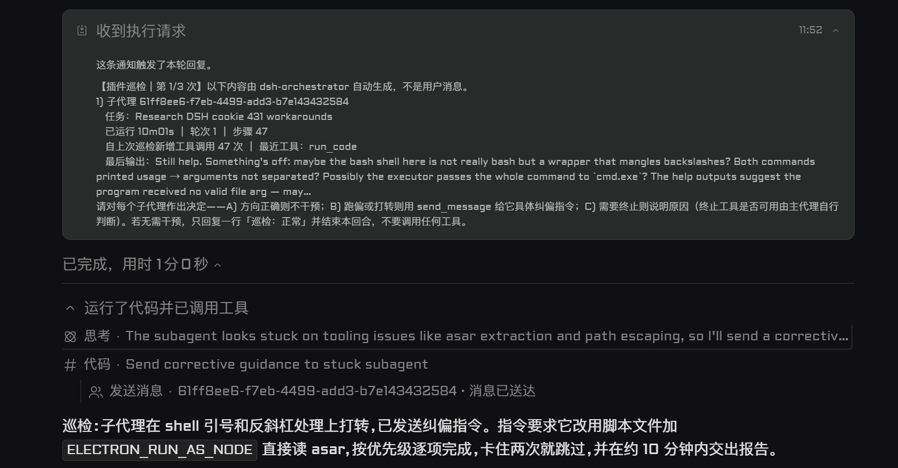

<div align="center">

*Start from 28th October*

<div align="center">

# dsh-orchestrator  

## 简体中文 | [English](README.md)

</div>

#### **主代理模型规划 + 子代理模型隔离执行 —— DeepSeek Harness 的「调度 · 监管 · 协调 · 汇总」主从编排插件**


[](https://github.com/SShiRkiT/dsh-orchestrator/releases/latest)
[](https://github.com/deepseek-ai/deepseek-harness)
[](https://github.com/SShiRkiT/dsh-orchestrator)
[](https://nodejs.org)
[](package.json)
[](LICENSE)
[](https://github.com/SShiRkiT/dsh-orchestrator/stargazers)
[](https://www.npmjs.com/package/@sshirkit/dsh-orchestrator)

[插件特点](#插件特点与能力补齐) · [核心优势](#七大核心优势) · [工具速查](#工具速查) · [安装与兼容](#安装与环境要求) · [面板与配置](#调度面板与配置说明) · [参与贡献](#参与贡献)

</div>

**dsh-orchestrator** 是面向 DeepSeek Harness（DSH）本地研发会话的主从编排插件：用硬门禁让**主代理**专心负责理解需求、拆分任务、过程把关与最终验收，让**子代理**在隔离环境里并行承担具体施工。

---

 https://github.com/user-attachments/assets/f540b545-c697-4bbc-abb2-d55f74041172

> [▶ 查看B站版本 (可以的话帮忙点个赞, 谢谢了ヽ(・∀・)](https://www.bilibili.com/video/BV1b7yBznEM9/)

---
<div align="center">

# 插件特点与能力补齐


它与 DSH 原生协作能力和平共存，重点为你补齐高强度研发最容易踩坑的四件事：
</div>

 **管住主模型，只动脑不打杂**  
>硬性收起主模型的读写和终端工具，防止强模型聊着聊着亲自下场翻代码、改文件  

 **独立工位隔离施工，验收后再合回**：  
>写任务默认在各自的 Git 临时目录中并行干活，不碰你当前工作区，不擅自合并到主分支。 

 **过程自动巡检，交工显式评审**：
> 后台定时查看运行中的子代理。卡壳或跑偏时，主代理可用 `send_message` 纠偏。\
> 交工后用 `worktree_manage` 查看隔离工作树的改动，再决定合回或丢弃。

 **批量活与多步流水线一键并行跑**：  
>同类批量或串联多步骤任务无需手写脚本，填好清单和步骤即可按并发上限自动推进，单条报错互不拖累

---

<div align="center">

# 七大核心优势

</div>

### 1. 管住主模型，专心规划不打杂

本插件直接给主模型上双锁——不该它碰的工具既看不见也调不了，只能专注拆解任务、派活、盯进度和把关；  

具体动手的事全交给子代理。关掉总开关就能一键恢复 DSH 原样，不需要重开会话。

  - 默认只放行 9 个管理动作
   >`delegate`、`orchestrate`、`delegate_status`、`worktree_manage`、`send_message`、`interrupt_agent`、`todo_write`、`ask_user_question`、`compress`
  - 按开关自动放行原生团队任务板
  （`team_task_*`）；
  - 其余读写、检索和终端工具默认收起，随时可在面板右侧勾选增减。

---

### 2. 每个任务单独开隔离目录，满意再合回

多个子代理同时改代码，最怕互相覆盖或弄乱你正在写的工作区。  
在 Git 仓库中，插件会默认给每个写任务拉出一个独立的临时工作目录。  
干完活也不会擅自合进主分支，必须等你或主模型看过改动、确认满意，再显式合并或直接丢弃。

> 由 `worktree_manage` 负责查看列表、审阅改动、合并（支持 `merge` / `squash` / `ff-only`）、丢弃与清理；  
>支持按需切换「自动隔离 / 强制隔离 / 共享目录」。目录清理或丢弃后，关联的旧子代理会被永久锁住，防止后续发消息误写回主目录。

---

### 3. 开工前协调写入范围

在非 Git 工作区或共享模式下，每个写任务通过 `writeScope` 声明修改范围。若实际路径重叠，插件会在启动前拒绝冲突的申请。写租约只协调声明范围，交工后由主代理另行验收。

> 随时调用 `delegate_status` 查看直属委派的运行状态、写租约状态及待评审的工作树。

---

### 4. 调度模式面板

在输入栏右侧的「调度模式」面板里，主模型和子代理模型彻底分开配置：  
  - 默认主模型与子模型都可以指定设置。

> 可在提示词或 `AGENTS.md` 中指定本轮或本工作区的子代理模型，由主代理派发时成对传入 `provider` 和 `model`，并按需添加 `reasoning_effort`。工作区的主代理模型仍可在 DSH 原生模型选择器中独立切换。

**在 `AGENTS.md` 或提示词中配置分级模型路由表**

可把下面的表写进工作区的 `AGENTS.md` 或直接放入提示词。这是供主代理阅读和应用的规则，插件不会解析表格。当前消息显式点名的路由优先于工作区规则。请把占位符替换成 DSH 中真实可用的 Provider ID 和 Model ID；任务未匹配时，省略三个路由参数。

| 任务类别 | `provider` | `model` | `reasoning_effort` |
| --- | --- | --- | --- |
| 轻量任务（如提取、分类） | `<轻量-provider-id>` | `<轻量-model-id>` | 省略 |
| 重量任务（如架构推演、复杂复核） | `<重量-provider-id>` | `<重量-model-id>` | `high`（模型支持时） |
| 其他任务 | 省略 | 省略 | 省略 |



---

### 5. 后台定时巡检

子代理干长活时，偶尔会卡在报错死循环里反复打转，或者跑偏目录，或者疯狂发散。  
插件会在后台按设定间隔翻看运行中子代理的工作记录，把近况合并成一条简短汇报推给主模型供主模型抉择，跑偏时会主动`send_message`一巴掌扇过去

> 翻看记录和汇总本身不花模型额度，只有在唤醒主模型做判断或纠偏时消耗少量主模型额度；  
> 通过 `send_message` 纠偏、`interrupt_agent` 止损，巡检间隔、次数上限或「无限巡检」均可在面板实时调整，并支持静默恢复 Todo 列表。




---

### 6. 热重载不断联，冷重启可对账

遇到插件热更新时，正在跑的子代理保持连接，后台巡检继续运行。彻底退出 DSH 再打开时，插件根据宿主状态核对工作树、委派和写租约。确认子代理已停止后释放租约，状态不明时保留保护。

> 插件使用宿主存储恢复记录，存储不可用时退回内存模式。\
> 彻底重启后不会自动续跑已中断的任务。

---

### 7. 批量活与多步流水线，填好清单自动跑

遇到“把 20 个文件逐一检查 → 修改 → 复核”这类批量或多步骤任务，不用一遍遍手动派活。只要给出任务清单和步骤顺序，插件就按并发上限自动推进：哪个条目做完第一步立刻进第二步，不用干等最慢的那条；单条失败不会拖垮整批，还能要求每步严格按格式交卷。

> 由 `orchestrate` 驱动，支持 1–64 个条目 × 1–8 个阶段、1–16 路并发（默认 4），每阶段可选 JSON 格式校验；隔离模式下按条目自动分配并跨阶段复用独立目录，不进入后台巡检。

显式指定某个阶段的模型时，在对应的 `stages` 条目中成对传入 `provider` 和 `model`，可同时传入 `reasoning_effort`。每个阶段按 **阶段覆盖 > 顶层批次覆盖 > 面板默认子代理路由** 的顺序选择整组路由，不跨层拼接，也不从后备路由继承推理强度。仅当某个阶段需要回退到面板默认路由时，才要求面板已配置子代理模型；缺失时整批不会启动。

---

<div align="center">

# 工具速查

</div>

本插件只向主代理提供 4 个编排与验收工具（子代理看不到）：

| 工具 | 做什么用 | 常用参数 | 注意事项 |
| --- | --- | --- | --- |
| `delegate` | 异步派活，优先复用 | `prompt`、`description`、`writeScope`（写任务必填）、`readOnly`、`isolation`、`allowNewReason`、`cwd`、`provider` + `model`、可选 `team_task_id` | 同一父会话存在可续跑的 `inactive` 子代理时拦截新建，返回 `delegate-reuse-required` 和 `details.candidates`。确需新建时传非空 `allowNewReason`。运行中受后台巡检覆盖。 |
| `orchestrate` | 批量 / 多步骤流水线自动并行跑 | `items`（1–64）、`stages`（1–8，可配 `schema`）、`maxConcurrency`（1–16，默认 4）、`writeScope`、`readOnly`、`isolation`、`cwd`、可选顶层 `team_task_id`；顶层或单个阶段均可指定 `provider` + `model`，可选 `reasoning_effort` | 路由优先级：阶段覆盖 > 顶层批次覆盖 > 面板默认；各条目独立推进，隔离模式按条目复用目录，同步等待，不进后台巡检 |
| `delegate_status` | 查询直属委派，或编辑闲置直属子代理的下一轮配置 | `action`（默认 `query`，可选 `summary` 或 `edit`）、`childId`（`edit` 必填）、`writeScope` / `readOnly`（`edit` 至少传一项）、`includeCompleted`（查询默认 `true`）、`limit`（1–64，默认 20） | `query` 查看运行、租约和工作树状态。`edit` 保存 `pendingNextTurn`，随后用 `send_message` 应用配置并唤醒同一个子代理。 |
| `worktree_manage` | 查看、审阅、合并、丢弃或清理隔离目录 | `action`（`list`/`inspect`/`merge`/`discard`/`prune`）、`worktreeId` / `childId`、`strategy`（`merge`/`squash`/`ff-only`）、`autoStageDirty`、`deleteAfterMerge`、`force`、`dryRun` | `inspect` 实时查看差异、提交和脏状态，含未跟踪路径。合并冲突时保留工作树供评审。清理或丢弃后锁定旧子代理。 |

从 v1.0.4 起，用 `delegate_status` 传入 `{"action":"summary","limit":5}` 即可查看只读交付摘要。总数统计当前根会话仍保留的全部委派，每个编排阶段计一条，`limit` 只限制明细。即使后来又派发了 64 条，也能用 `childId` 精确查询。待评审项给出工作树 ID，已合回项给出记录的合回提交，投递结果未知项给出可核对的动作键。宿主已接收唤醒但尚待运行确认的委派单独列出。

复用闲置子代理时，如需调整写范围或只读设置，先调用 `delegate_status` 并指定 `action: "edit"`，再用 `send_message` 唤醒同一个子代理。插件在投递前用 `replaceOwnerLease` 原子替换写租约。租约冲突会阻止投递，明确拒投时回滚租约替换并恢复待应用配置。投递结果不明时保留新租约保护，并阻止重复唤醒。

`readOnly` 仅在当前会话开启「启用只读参数」时可用。将下一轮配置编辑为只读也受此开关控制。关闭时，做只读调研请传 `isolation: "shared"`，保留必填的 `writeScope` 声明，并在任务说明里明确禁止修改文件。

宿主根会话已开启原生「智能体团队协作」，且调度模式放行当前会话的 `team_task_create` 时，主代理可在派发复杂任务前建立共享目标，将工具返回的 `id` 作为 `team_task_id` 传给子代理（编排时传给每个阶段）。子代理可在 `team_task_get` 可用时读取目标作为参考；任务说明仍须自包含，共享目标不替代派发或写租约。

---

<div align="center">

# 安装与环境要求

</div>

| 项目 | 要求 |
| --- | --- |
| **宿主环境** | DeepSeek Harness Desktop / Web GUI |
| **宿主版本** | `>= 0.2.2-rc.2 < 0.2.3-0`（已实测验证至 **`0.2.2-rc.5`**） |
| **Node.js** | `>= 22`（内置于 DSH Desktop 运行时） |
| **插件形态** | Cordis 后端服务补丁（`cordis.patch.yml`）+ Web GUI 客户端扩展（`lib/client.js`） |
| **界面语言** | 中 / 英双语自适应（`zh-CN` / `en-US`） |

<div align="center">

# 版本兼容说明
</div>  

| npm 包 | 插件版本 | 适配的 DSH 宿主 | 说明 |
| --- | --- | --- | --- |
| `@sshirkit/dsh-orchestrator` | `v1.0.0` 起 | **DSH `>= 0.2.2-rc.2 < 0.2.3-0`** | 持续维护，已实测验证至 `0.2.2-rc.5`。不兼容 `0.2.2-rc.1` 及更早宿主；`wait_agent` 默认不放行（由事件交付与旁路巡检替代阻塞轮询），确有需要可在面板手动勾选。 |
| `dsh-orchestrator`（早期无作用域包） | `v0.8.0` – `v0.8.2` | **DSH `<= 0.2.2-rc.1`** | 暂时无法升级宿主时，请停留在 `v0.8.2`。 |

<div align="center">

# 安装方式
</div>

**方式一：DSH GUI 安装**

在 DSH 插件页选择「**添加插件 → 安装第三方插件**」，填入以下任一有效标识（推荐第一种或 npm 包名）：

```text
https://github.com/SShiRkiT/dsh-orchestrator
github:SShiRkiT/dsh-orchestrator#main
@sshirkit/dsh-orchestrator
```

**方式二：CLI 安装**

```bash
# 从 GitHub 安装
dsh plugin --profile desktop add https://github.com/SShiRkiT/dsh-orchestrator
# 或从 npm 安装
dsh plugin --profile desktop add @sshirkit/dsh-orchestrator
```

> 首次安装或更新客户端扩展后，如果输入栏右侧未显示「调度模式」面板，请完全退出并重启 DSH 客户端。

---

<div align="center">

# 调度面板与配置说明

</div>

## 输入栏右侧「调度模式」面板

面板自动跟随 DSH 语言切换中 / 英文，提供免重启的实时控制项：

- **启用调度模式**可切换主代理工具白名单闸门，已打开的会话立即跟随生效。
- **主代理 / 子代理默认模型与推理强度**均可通过关键词搜索选择。全局模式下，主代理默认路由写入宿主 `agent-default-model`。子代理路由在下一次派发时使用，任务或阶段仍可显式覆盖。
- **子代理巡检间隔 / 巡检次数 / 无限巡检**可在运行中动态调整。
- **右侧 `Allowed Tools` 列表**支持按关键字搜索、勾选主代理可用工具和重置白名单。

自 `v1.0.3` 起，右栏顶部的「**仅当前会话**」开关和「**更多**」按钮位于分隔线上方，作用范围覆盖整个面板。开启后会保存当前设置的会话快照，之后的修改也只保存到当前会话。快照涵盖以下 10 项：`enabled`、`worktreeIsolationEnabled`、`readOnlyEnabled`、`peerReadOnlyConsultEnabled`、`mainRoute`、`workerRoute`、`superviseIntervalSeconds`、`superviseMaxNoticesPerChild`、`superviseUnlimited`、`allowedTools`。

会话模式会保留全局配置与宿主 `agent-default-model`。会话级主代理模型从下一个尚未准备的模型调用步骤（step）起生效。关闭「仅当前会话」会清除覆盖，自动恢复当前的全局默认模型及全局设置。若会话存储不可用，开关会禁用，仍可明确选择编辑全局设置。

点击「**更多**」会在会话中央打开独立浮窗，可用关闭按钮、`Esc` 或点击遮罩关闭：

- **默认启用 Git Worktree 隔离**（`worktreeIsolationEnabled`，默认 `true`）控制 `isolation: "auto"` 下 Git 写任务的隔离行为。
- **启用只读参数**（`readOnlyEnabled`，默认 `false`）控制 `delegate` 和 `orchestrate` 是否显示、接受 `readOnly`。关闭时，模型会被引导使用 `isolation: "shared"` 做无需隔离的只读调研。开启时建议同时打开「允许平级询问」。
- **允许平级询问**（`peerReadOnlyConsultEnabled`，默认 `false`）让同一会话中同属一个父代理的子代理共享已读文件索引，并用 `send_message` 互相咨询已读上下文。索引仅包含路径和位置信息。主代理会静默过滤已识别的平级咨询转发。

在新会话输入栏居中（Hero 布局）时，调度面板会避开顶部导航栏，按视口内可用空间自动向上或向下展开，减少截断。

## 配置项速查表

以下 15 项用户可配参数均为 `volatile` 动态热配置，修改后无需重启 DSH（执行门禁每次调用重读、工具面下一次请求生效、子代理路由下一次派发生效）：

| 配置项 | 默认值 | 说明 |
| --- | --- | --- |
| `enabled` | `true` | 调度模式总开关。关闭后一键恢复宿主原生工具面；`delegate` / `orchestrate` 仍禁用，已绑定巡检回合的硬禁仍优先。 |
| `worktreeIsolationEnabled` | `true` | 控制 `isolation: "auto"` 下是否为 Git 写任务创建独立 Worktree。非 Git 工作区使用共享模式，由写租约协调声明范围。 |
| `readOnlyEnabled` | `false` | 开启后 `delegate` / `orchestrate` 可使用 `readOnly`。关闭时隐藏并拒绝该参数，模型会获得使用共享工作区做只读调研的提示。 |
| `peerReadOnlyConsultEnabled` | `false` | 开启后同一会话的平级子代理可共享已读文件索引，并通过 `send_message` 咨询。 |
| `allowedTools` | 未配置（默认 9 项基础工具；`allowAgentTeam: true` 时自动追加已注册的 4 项原生 Team 工具） | 主代理显式工具白名单。显式数组（包括 `[]`）会**替换**默认名单。关闭「仅当前会话」开关时，右侧 `Allowed Tools` 列表的改动实时写入此项。 |
| `allowAgentTeam` | `true` | 只控制调度模式下主代理能否调用原生 Team 任务板工具（`team_task_*`），不切换宿主「智能体团队协作」模式。设为 `false` 时优先于会话和全局白名单。宿主根会话已开启原生 Team 且会话放行 `team_task_create` 时，主代理可建立共享目标并用可选 `team_task_id` 传给子代理读取。 |
| `workerProvider` | `""` | 子代理默认路由 Provider。未命中任何显式路由覆盖时，必须同时配置此项和 `workerModel`；不会回退到主模型。 |
| `workerModel` | `""` | 子代理默认路由 Model；约束同上。 |
| `workerReasoningEffort` | `""` | 子代理默认推理强度；留空则由所选子代理模型自行决定默认值。 |
| `superviseEnabled` | `true` | 子代理后台旁路巡检总开关（位于宿主插件设置卡片）。 |
| `superviseIntervalSeconds` | `600` | 旁路巡检间隔（秒），范围 `10–86400`，运行中修改立即生效。 |
| `superviseMaxNoticesPerChild` | `3` | 每个子代理最多触发的巡检通知次数（`0–20`）。未开启无限巡检时，`0` 表示关闭巡检。 |
| `superviseUnlimited` | `false` | 无限次数巡检开关。开启后忽略 `superviseMaxNoticesPerChild` 上限（含 `0`），持续按间隔巡检直至子代理停止、交付或结束。 |
| `superviseNotifyOnNoProgress` | `false` | 子代理日志无新活动时是否仍然发送巡检通知（位于宿主插件设置卡片；开启 `superviseUnlimited` 时等效于始终通知）。 |
| `restoreTodoOnSupervision` | `true` | 巡检时按有效快照静默补写 `todo/write` 恢复 Todo UI 状态，不增加模型历史、不消耗模型 Token（位于宿主插件设置卡片）。 |

> 注：配置架构中另含 `toolCatalog` 字段，系插件运行时自动发布的**内部只读工具目录镜像**（用于向 Web 面板同步宿主当前已注册工具清单），无需手动编辑。主代理默认模型存储于宿主的 `agent-default-model`，由同一「调度模式」面板读写。

---

<div align="center">

# 参与贡献

</div>

本项目先维护中文版，再同步英文版。以下文档涵盖项目术语、架构决策、贡献流程与社区支持：

- 项目术语表 [`GLOSSARY.md`](docs/GLOSSARY.md)
- 架构决策记录（ADR）[`docs/adr/`](docs/adr/)
- 版本发布说明 [`docs/releases/`](docs/releases/)
- 贡献指南 [`.github/CONTRIBUTING.md`](.github/CONTRIBUTING.md)
- 行为准则 [`.github/CODE_OF_CONDUCT.md`](.github/CODE_OF_CONDUCT.md)
- 安全策略与漏洞私密报告 [`.github/SECURITY.md`](.github/SECURITY.md)
- 支持与求助 [`.github/SUPPORT.md`](.github/SUPPORT.md)
- 无障碍说明 [`.github/ACCESSIBILITY.md`](.github/ACCESSIBILITY.md)

<div align="center">

# License

</div>

[MIT](LICENSE) © 2026 [SShiRkiT](https://github.com/SShiRkiT)
